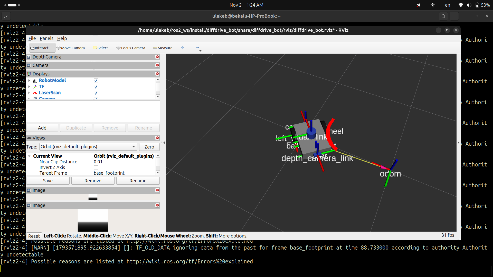
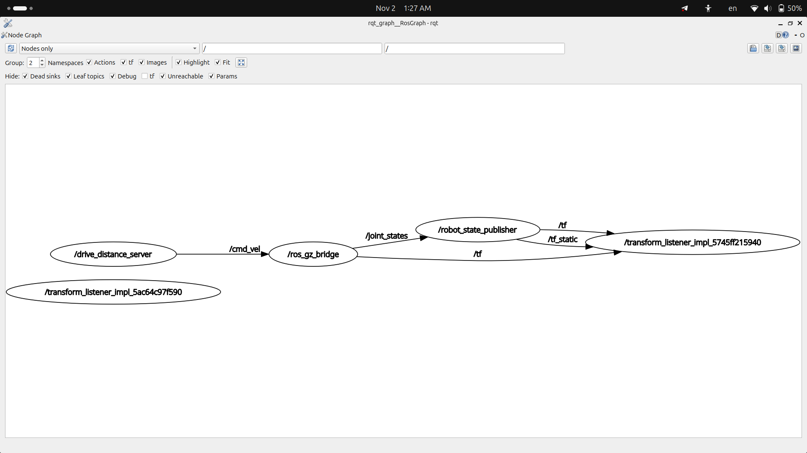

# Lab 1: diffdrive_bot

**Name:** Bekalu Addissu

**ID:** UGR/9538/16

**Course:** Introduction to Robotics and Intelligent Systems  

---

## What is in this folder
This repository has 4 packages for Lab 1:
- `diffdrive_bot`: the robot model with the new depth camera and IMU.
- `lab_interfaces`: base message and action types.
- `my_robot_interfaces`: my custom msg, srv, and action files.
- `my_robot_nodes`: my python scripts to drive the robot.

---

## How to build
Open a terminal, source ROS 2, and build:

```bash
source /opt/ros/jazzy/setup.bash
cd ~/ros2_ws
colcon build --symlink-install
source install/setup.bash
```

---

## Screenshots

### 1. Step 1 - RViz Depth Camera and Point Cloud
RViz showing the wall behind the robot with the new depth camera:



### 2. Step 7 - rqt_graph during square.launch.py
The rqt_graph showing all active nodes while the robot drives in a square:



---

## How to run each step

### Step 1: Depth camera and IMU
Start the robot in simulation:
```bash
ros2 launch diffdrive_bot gazebo.launch.py
```
Check the IMU:
```bash
ros2 topic hz /imu
```

### Steps 2 to 5: Obstacle avoidance (`turn_away`)
In terminal 1, start the robot:
```bash
ros2 launch diffdrive_bot control.launch.py
```
In terminal 2, run the node:
```bash
ros2 run my_robot_nodes turn_away
```
In terminal 3, turn it on or change speed:
```bash
ros2 service call /turn_away_enable std_srvs/srv/SetBool "{data: true}"
ros2 service call /set_turn_speed my_robot_interfaces/srv/SetTurnSpeed "{turn_speed: 0.8}"
ros2 param set /turn_away forward_speed 0.3
ros2 service call /turn_away_enable std_srvs/srv/SetBool "{data: false}"
```

### Step 6: Rotate action server
In terminal 2, start the server:
```bash
ros2 run my_robot_nodes rotate_server
```
In terminal 3, send a goal to turn 90 degrees (1.57 rad):
```bash
ros2 action send_goal --feedback /rotate my_robot_interfaces/action/Rotate "{angle: 1.57}"
```

### Step 7: Drive in a square
Run everything with one command:
```bash
ros2 launch my_robot_nodes square.launch.py side_length:=0.8
```

---

## What did not work and why

1. **Anaconda Python error:**  
   At first, `colcon build` gave an error saying `No module named 'em'`. This happened because Anaconda was active in my terminal and ROS 2 picked Anaconda's python instead of system python. Deactivating conda (`conda deactivate`) fixed it.

2. **Angle jumping when turning:**  
   When writing the rotate server, subtracting the start angle from current angle caused jumps when turning past 180 degrees (because yaw jumps between +pi and -pi). To fix this, I added up small angle changes between each odometry update instead.
